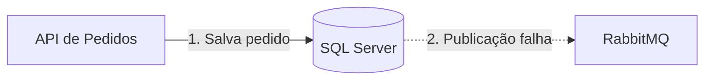
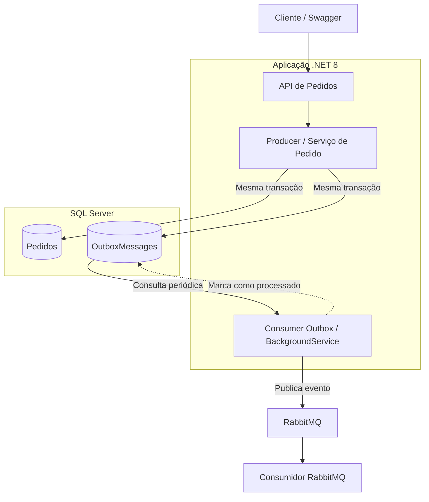

# Transactional Outbox Pattern | .NET 8 + RabbitMQ + SQL Server

   

> **E se o pedido for salvo no banco, mas o evento não chegar ao RabbitMQ?**

Criei este laboratório para investigar uma situação comum em sistemas que trabalham com persistência e mensageria: a **dupla escrita (dual-write)**. A ideia não era apenas implementar um fluxo que funcionasse, mas entender o que acontece quando uma dependência falha e como o padrão **Transactional Outbox** ajuda a lidar com isso.

O estudo também virou uma apresentação em um encontro técnico de backend na empresa, em que compartilhei os conceitos, a implementação e as limitações que observei.

## 🎯 O problema

Em um fluxo tradicional, a API pode realizar duas operações independentes:

1. Salvar o pedido no SQL Server.
2. Publicar um evento no RabbitMQ.

Se a primeira operação funcionar e a segunda falhar, o pedido estará persistido, mas outros componentes não receberão o evento esperado. **Uma transação do banco não torna a publicação no broker parte do mesmo commit.**



## 💡 Como o Outbox ajuda

Em vez de depender da publicação imediata no broker, a aplicação grava **o pedido e o registro do evento na tabela Outbox na mesma transação do SQL Server**.

- **Commit:** pedido e evento ficam persistidos juntos.
- **Rollback:** nenhum dos dois é confirmado.
- **Publicação posterior:** um serviço em segundo plano consulta eventos pendentes e tenta publicá-los no RabbitMQ.

Isso reduz o risco de perder um evento quando o broker está temporariamente indisponível. **Não significa entrega exatamente uma vez.**



> **Detalhe da implementação:** neste laboratório, o producer e o serviço que processa a Outbox estão na **mesma API**. Não criei um microsserviço separado só para publicar as mensagens.

## 🧰 Tecnologias utilizadas

| Tecnologia | Papel no laboratório |
| --- | --- |
| **C# / ASP.NET Core 8** | API de pedidos e processamento em segundo plano |
| **Entity Framework Core** | Persistência e migrations |
| **SQL Server 2022** | Dados dos pedidos e registros da Outbox |
| **RabbitMQ 3 (Management)** | Broker de mensagens e interface de acompanhamento |
| **Docker Engine + WSL2 (Ubuntu)** | Execução local dos serviços de infraestrutura |
| **Swagger** | Exercício dos endpoints da API |

## 🔄 Fluxo implementado

1. Envio uma requisição para criar um pedido pela API.
2. A aplicação persiste o pedido **e** o evento de Outbox na mesma transação.
3. Um `BackgroundService` verifica periodicamente os registros ainda não processados (`ProcessedOnUtc IS NULL`).
4. O serviço tenta publicar os eventos no RabbitMQ.
5. Após a publicação, atualiza o registro correspondente na Outbox como processado.

**Atenção:** marcar a mensagem como processada depois da publicação deixa uma janela em que uma falha pode provocar uma **nova publicação**. Por isso, consumidores idempotentes são importantes.

## 🖥️ Ambiente de desenvolvimento

Montei o laboratório em um computador com **Windows 11**, executando a API localmente e o **SQL Server** e o **RabbitMQ** em contêineres Docker dentro do **WSL2 / Ubuntu**. A configuração dos contêineres e volumes foi mantida no disco D:.

Portas utilizadas no ambiente:

| Serviço | Endereço local |
| --- | --- |
| SQL Server | `localhost:1433` |
| RabbitMQ (AMQP) | `localhost:5672` |
| RabbitMQ Management | `http://localhost:15672` |

### Executando o laboratório

**Pré-requisitos:** SDK .NET 8, WSL2/Ubuntu com Docker Engine e contêineres de SQL Server e RabbitMQ configurados.

**1. Inicie o Ubuntu/WSL2 e os contêineres**

No PowerShell:

```powershell
wsl -d Ubuntu
```

No Ubuntu:

```bash
sudo service docker start
docker start outbox-sql outbox-rabbitmq
docker ps
```

> Os nomes `outbox-sql` e `outbox-rabbitmq` correspondem ao meu ambiente local. Ajuste-os caso seus contêineres tenham outros nomes.

**2. Configure a conexão com os serviços**

Revise as configurações da API para apontar para o SQL Server e o RabbitMQ em execução. **Não publique senhas reais ou connection strings com credenciais no repositório.** Prefira variáveis de ambiente ou User Secrets.

**3. Prepare o banco e execute a API**

Na pasta da solução, restaure as dependências:

```bash
dotnet restore
```

Aplique as migrations do EF Core conforme os projetos de inicialização e de dados da solução. Em seguida, execute o projeto da API pelo Visual Studio ou com `dotnet run` na pasta correta.

> **Ajustar antes de publicar:** incluir aqui os caminhos reais do projeto de API e do projeto que contém as migrations, além do comando `dotnet ef database update` com os parâmetros `--project` e `--startup-project` adequados.

**4. Teste pelo Swagger**

Abra o Swagger na URL exibida durante a inicialização da API e utilize o endpoint de criação de pedidos. Observe os registros no SQL Server e a atividade do RabbitMQ Management.

> **Ajustar antes de publicar:** informar a URL exata do Swagger e os endpoints disponíveis na versão final do código.

## 🧪 Cenários que investiguei

| Cenário | O que observar |
| --- | --- |
| **Fluxo normal** | Pedido e Outbox são persistidos; o evento é publicado e marcado como processado. |
| **Falha na persistência** | Sem commit, o pedido e o evento não devem ficar gravados parcialmente. |
| **RabbitMQ indisponível** | O evento permanece na Outbox para nova tentativa; a indisponibilidade do broker não desfaz uma transação já confirmada. |
| **Broker volta a funcionar** | O processamento pode retomar e tentar publicar eventos pendentes. |

Esses são os cenários usados para estudar o comportamento do padrão. O resultado concreto depende das condições de teste e da implementação do serviço de publicação.

## ⚠️ Outbox não é mágica

O padrão ajuda a resolver o problema da dupla escrita, mas não elimina outras preocupações de sistemas distribuídos:

- **Mensagens duplicadas:** a publicação pode ocorrer mais de uma vez; consumidores devem ser idempotentes.
- **Concorrência entre workers:** múltiplas instâncias exigem coordenação para evitar processamento simultâneo indevido.
- **Ordenação de eventos:** a ordem de publicação e consumo precisa ser considerada.
- **Crescimento da Outbox:** é necessário pensar em retenção e limpeza.
- **Observabilidade:** eventos pendentes, falhas e atrasos precisam ser monitorados.
- **Falhas permanentes:** políticas de retentativa e tratamento de mensagens problemáticas são necessárias.

Uma evolução possível é combinar **Transactional Outbox + consumidor idempotente + Inbox Pattern**, conforme a necessidade do sistema.

## 📚 O que levei deste estudo

O principal aprendizado foi perceber que **persistir dados com sucesso não garante que o restante do sistema recebeu o evento correspondente**. Construir o laboratório e discutir o assunto com o time me ajudou a enxergar melhor os compromissos envolvidos em confiabilidade, consistência e mensageria.

Este repositório é um **projeto de estudo e demonstração**, não um modelo pronto para produção. A intenção é documentar o que implementei, as situações que testei e as questões que ainda merecem aprofundamento.

---

**Assuntos:** `dotnet` · `csharp` · `transactional-outbox` · `rabbitmq` · `sql-server` · `docker` · `distributed-systems` · `backend`
